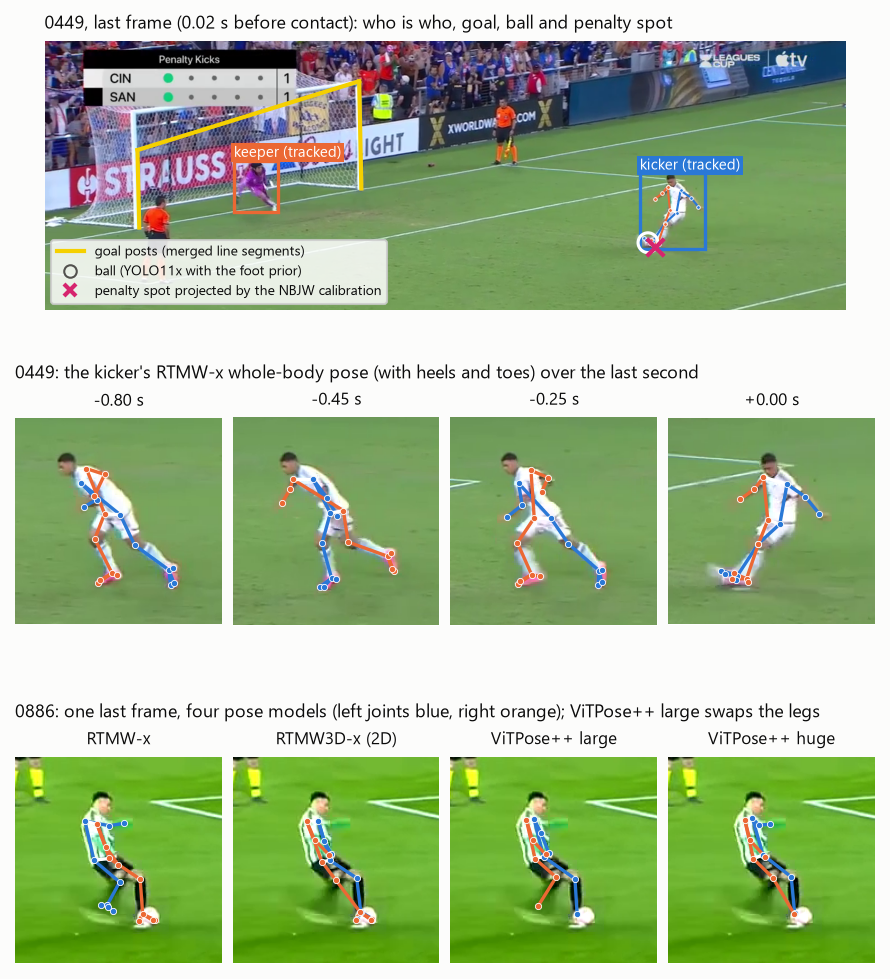
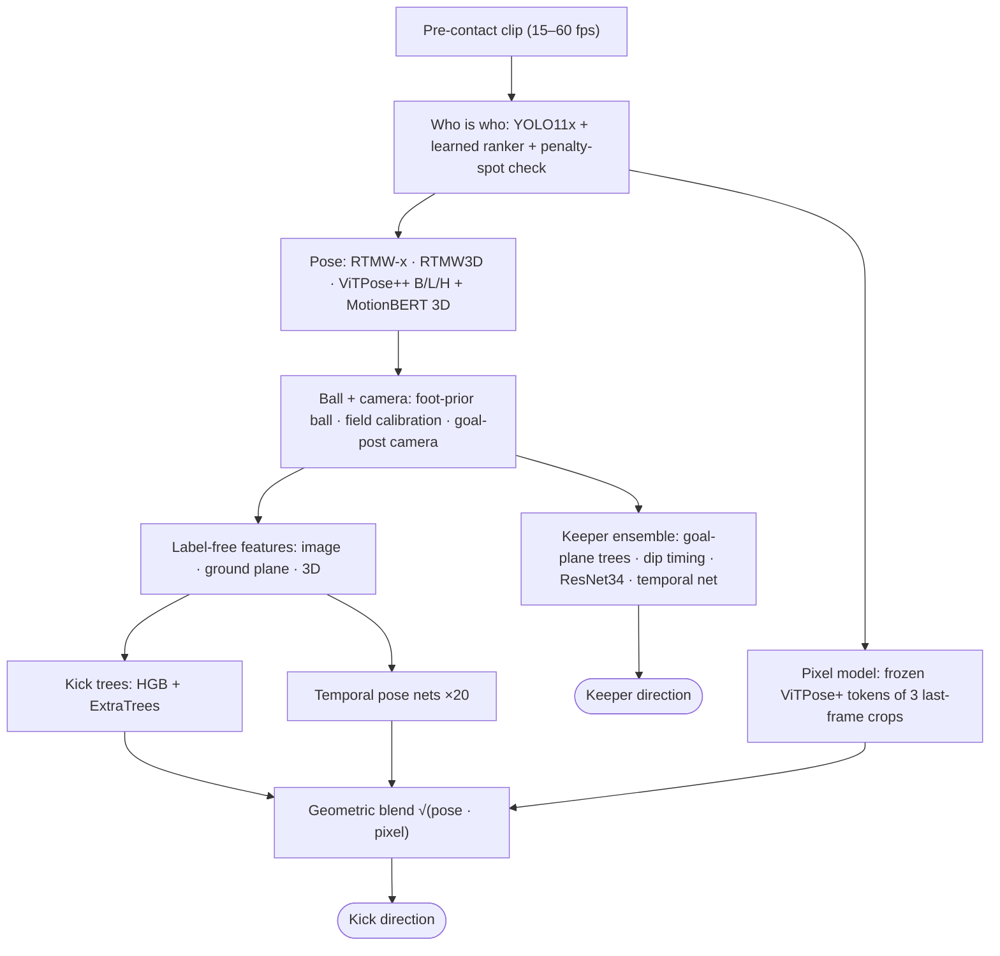
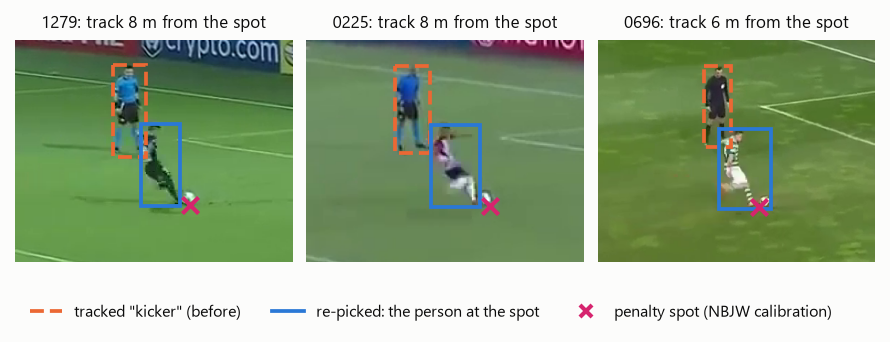
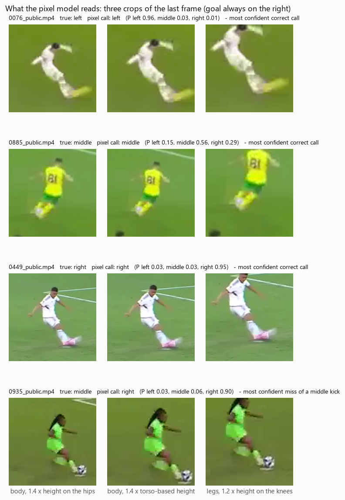
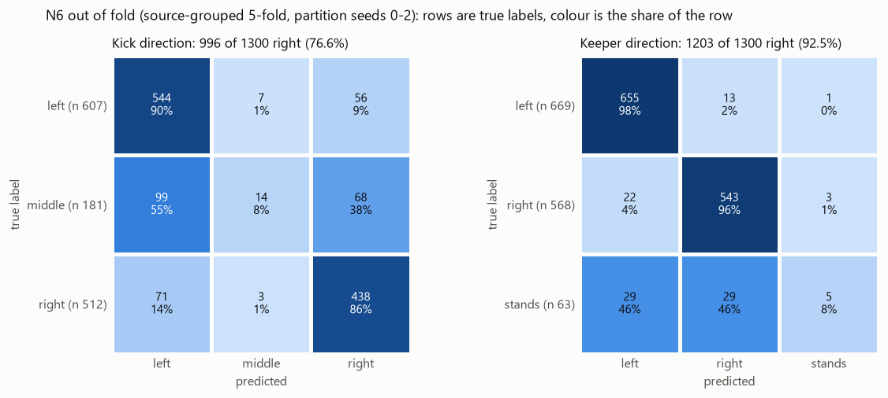

<div align="center">

# ⚽ Penalty Kick Prediction

**Predict where a penalty goes, and where the goalkeeper dives, from broadcast video that stops 0.02 s *before* the foot touches the ball.**


-20BEFF?logo=kaggle&logoColor=white)



<sub>Perception on labelled clips. Top: the last frame, 0.02 s before contact, with the tracked kicker and keeper, goal posts, the ball and the penalty spot projected by a field calibration. Middle: the kicker's whole-body pose over the last second. Bottom: four pose models on one frame. One of them swaps left and right, which is why every feature is built to be left/right-label-free.</sub>

</div>

---

## The problem

Every clip is a broadcast penalty that **ends just before contact**, so the kick itself is never shown. For each of 900 unseen clips, predict:

| Target | Classes | Weight |
|---|---|---:|
| **Kick direction** | left · middle · right | 70 % |
| **Goalkeeper direction** | left · stands in the middle · right | 30 % |

Directions are from the kicker's point of view, and the score is weighted accuracy.

Why it's hard:
- **The answer happens after the video ends.** The signal is in the run-up, the body just before contact and the keeper's first movement. Middle kicks (14 %) and standing keepers (5 %) are mostly decided *at* contact.
- **Small, blurry players in many camera angles.** Kickers are often ~100 px tall, and pose models swap their left and right joints. Behind, side-on, high and low cameras all change what a "left kick" looks like.
- **Little data, unseen sources.** 1,300 labelled clips come from ~136 source videos, and almost every test source is new. Frame rates range from 15 to 60 fps.
- **A noisy public leaderboard.** 360 clips means a sampling SD of ~0.02, larger than most single improvements.

## Results

| | Score |
|---|---:|
| **Kaggle public leaderboard** | **0.83361** |
| "Educated guess" baseline (kick and keeper to the kicker's natural side) | 0.52277 |
| Source-grouped 5-fold CV (4 partition sets) | 0.8142 ± 0.0030 |
| Kick accuracy (CV) | 76.8 % |
| Goalkeeper accuracy (CV) | 92.3 % |

The model isn't guessing. With the predictions fixed and labels reshuffled 100,000 times, the metric drops to 0.443 ± 0.010, 38 SD below the real score. Against the natural-side baseline it wins 396 kick clips to 52 (McNemar p ≈ 10⁻⁶⁷), and it is ahead in every subgroup: frame rate, resolution, foot, gender, camera side and class.

<details>
<summary><b>Version history and ablation (each row adds one component)</b></summary>

| Version | Component added | Kick acc. (CV) | CV metric | Public |
|---|---|---:|---:|---:|
| v10 | First pipeline: YOLO11x, RTMW / ViTPose++ pose trees, temporal nets, keeper CNN | 71.3 % | 0.773 | 0.777* |
| P4 | Foot-prior ball, ground-plane camera, goal-plane keeper, MotionBERT channels | – | – | 0.815 |
| P4rkT | + spot ball, keeper network, kicker re-pick (*pose readers only*) | 73.3 % | 0.790 | 0.819 |
| – | *Pixel model alone* | 74 % | – | – |
| P4rkD | + pixel model, linear blend, crops on the right kicker | 76.5 % | 0.812 | 0.836 |
| N4 | + geometric blend | 76.6 % | 0.813 | 0.836 |
| **N6** | + keeper dip timing and "committed yet?" flags | **76.6 %** | **0.814** | **0.834** |

\*Scored with the earlier three-label metric. The pose readers (73.3 %) and the pixel model (74 %) are each well below their blend (76.6 %).
</details>

## How it works



### 1 · Perception: who, where and how they move
- **Detection and identity.** YOLO11x finds people and the ball, and GroundingDINO finds the goal. A learned ranker picks the keeper, then the kicker given the keeper; it agrees with hand annotations on 99.8 % / 99.5 % of held-out clips.
- **Physics-based sanity checks.** 0.02 s before contact the kicker *must* stand at the ball on the penalty spot. A field calibration (No Bells, Just Whistles) projects the spot into the frame. This label-free check caught 32 clips where tracking had drifted onto the referee, clips the model had been reading at 35 % accuracy.
- **Five pose models kept as separate streams** (RTMW-x whole-body with toes and heels, RTMW3D, ViTPose++ base/large/huge), plus MotionBERT for 3D. Forcing them to agree *cost* accuracy: their diversity is worth more than cleaner joints.
- **Ball and camera.** The kicking foot must be at the ball, so ball candidates are re-scored with a foot-distance prior (moving 244 balls). An orthographic camera is fitted to the 11 m spot distance and 7.32 m goal width to put points on the ground in metres.

<p align="center">
  
  <br><sub>The label-free kicker check. The tracked "kicker" (dashed) was the referee, 6–8 m from the projected spot (×), so the person standing on the spot (solid) is used instead.</sub>
</p>

### 2 · Features that don't trust left/right labels
No feature depends on a pose model's left/right joint labels. The kicking foot is whichever foot travels farther, and body lines are axes taken modulo 180°. Every feature lives in a frame where **a left/right mirror is exact**, so mirrored clips double the training data and serve as test-time augmentation.

### 3 · Three readers of the kick
- **Kick trees:** histogram gradient boosting + ExtraTrees per pose stream, on ~400 kinematic features (run-up angle and speed, plant and kicking foot relative to the ball, hip and shoulder axes, lean).
- **Temporal pose networks:** residual dilated 1D convolutions over the last second of pose. Each pose stream is a separate training sample (measurement-noise augmentation), and 20 members are averaged.
- **Pixel model, the biggest single gain:** a **frozen ViTPose+ backbone** encodes three last-frame crops, followed by PCA and a **camera-aware logistic head**, which in effect is a separate linear model per camera side and kicking foot. Most of its signal turned out to be the **motion blur of the swinging leg**. Left/right AUC falls from 0.83 at the last frame to 0.60 at −0.2 s. Frozen features beat fine-tuning (0.887 vs 0.818) with only 1,300 clips.

The final kick prediction is the geometric mean of the pose readers and the pixel model, `normalise(√(pose · pixel))`, which beat a linear blend on every partition set.

<p align="center">
  
  <br><sub>What the pixel model sees: three crops of the last frame, stabilised, centred on the kicker and mirrored so the goal is on the right.</sub>
</p>

### 4 · The goalkeeper
Keeper motion is decomposed along the goal line and vertically, in the camera's goal plane. **Dip timing** features (time since the keeper's last up/down turn, depth of the dip) and "committed yet?" flags capture whether the keeper has already chosen a side. Goal-plane trees, a fine-tuned ResNet34 on goal-aligned keeper crops and a temporal network are blended.

## Validation discipline

- **Source-grouped, stratified 5-fold CV.** A clip is never predicted by a model that saw any clip from its source video. Every result is repeated over several partition seeds.
- **Rules before results.** From November 4th, every candidate change had a rule file *written before its first result*. The file fixed the variants, a fresh, never-used decisive seed set, and the acceptance thresholds. The public leaderboard was only used to confirm a CV-chosen file.
- **Test clips are processed independently:** no pooling, normalisation or pseudo-labelling across them.

<p align="center">
  
</p>

**Where points are still lost:** 48 % are missed middle kicks (8 % recall), which are mostly decided at contact. 37 % are wrong-side kicks and 12 % keeper errors, mostly missed "stands".

## Run it

The whole pipeline lives in one executed notebook, [`notebooks/penalty_kick_pipeline.ipynb`](notebooks/penalty_kick_pipeline.ipynb). It writes every script with `%%writefile`, runs them, and rebuilds the final submission byte for byte from cached perception outputs. The final CPU run took 79 minutes on a laptop with an RTX 5070 Ti.

To run from scratch:
1. Set `PROJECT_ROOT` in Section 0. The notebook expects `Q4data/` (competition data) under it, and makes its own run folder.
2. Put the third-party weights where Section 0 lists them: YOLO11x, MotionBERT-Lite, No Bells Just Whistles (`SV_kp`, `SV_lines`) and WASB-SBDT. ViTPose++, GroundingDINO, RTMW/RTMW3D, ResNet34 and DINOv3 download on first use (set `HF_HUB_OFFLINE="0"` for the first run).
3. Install the packages in [`code/environment.txt`](code/environment.txt) (Python 3.14, PyTorch 2.14 + CUDA). An NVIDIA GPU is needed for the perception stages.
4. Run all cells. GPU stages run when their outputs are missing (or set `HEAVY = True`), which takes many GPU-hours.

CPU stages are seeded and deterministic. GPU training is not bit-exact, so a from-scratch run can change a few predictions. The competition videos, the ~27 GB of cached perception outputs and the third-party weights aren't redistributed here.

## Repository layout

```
notebooks/penalty_kick_pipeline.ipynb   the executed end-to-end notebook (the source of truth)
code/scripts/                           the 88 scripts exactly as the notebook writes them
code/first_pipeline/                    the first pipeline that produced the cached perception inputs
code/run/                               notebook build + clean-room execution helpers
code/report_figures/                    scripts for the perception figures
code/dev/                               development scripts referenced in comments (not run)
submission/submission_N6.csv            the final Kaggle submission
docs/technical-report.pdf               full write-up: method, ablations, statistics
```

## Built on

YOLO11x (Ultralytics) · GroundingDINO · RTMW / RTMW3D · ViTPose / ViTPose++ · MotionBERT · No Bells, Just Whistles · WASB-SBDT · DINOv3 · ResNet34 · scikit-learn. The model identifiers are listed in the notebook's first cell.

---

<sub>Built for the Penalty Kick Prediction Kaggle competition in NYU Tandon's CS-GY 6643 Computer Vision (Fall 2026). Full write-up: [docs/technical-report.pdf](docs/technical-report.pdf).</sub>
